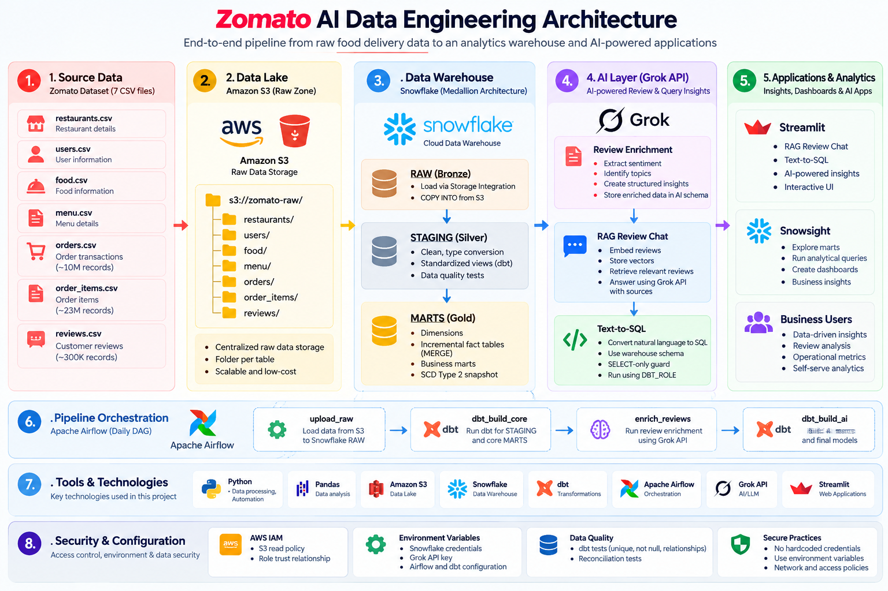

# Zomato AI Data Engineering

An end-to-end data engineering and AI analytics platform built around a Zomato-style food delivery business scenario.

The project addresses a practical business problem: large volumes of restaurant, customer, order, order-item, menu, and review data need to be ingested, cleaned, modeled, monitored, and made useful for both business analysis and natural-language AI applications.

---

## Business Problem

A food-delivery business generates data across multiple operational areas:

- Restaurants
- Customers
- Food and menus
- Orders
- Order items
- Customer reviews

As the volume of this data grows, a business faces several practical challenges:

1. Raw CSV data is difficult to manage and analyze at scale.
2. Source data needs a reliable cloud landing zone before warehouse processing.
3. Raw data cannot be used directly for consistent business reporting.
4. Large fact tables should not be rebuilt from scratch for every pipeline run.
5. Business teams need trusted metrics such as revenue, order performance, delivery performance, and review insights.
6. Free-text reviews contain useful information that is difficult to analyze with traditional structured queries.
7. Analysts may know the business question but not the SQL required to retrieve the answer.
8. The pipeline needs orchestration, data-quality checks, and controlled access to remain reliable.

### Business Goal

Build a reusable data platform that transforms raw food-delivery data into:

- Trusted analytical datasets
- Incremental warehouse models
- Business-ready marts
- AI-enriched review data
- Searchable review intelligence
- Natural-language warehouse querying
- Self-service analytical applications

---

## Proposed Solution

The project implements a modern cloud data platform:

```text
Source CSV Data
      |
      v
Amazon S3
      |
      v
Snowflake RAW
      |
      v
dbt STAGING
      |
      v
dbt MARTS
      |
      +-------------------------+
      |                         |
      v                         v
Business Analytics          AI Layer
                              |
                  +-----------+-----------+
                  |           |           |
                  v           v           v
              Enrichment    RAG      Text-to-SQL
                  |           |           |
                  +-----------+-----------+
                              |
                              v
                    Streamlit / Snowsight
```

Apache Airflow orchestrates the batch workflow from ingestion through AI mart generation.

---

## Architecture



The architecture separates the platform into data ingestion, warehouse transformation, AI capabilities, applications, orchestration, and supporting security/configuration components.

---

## What the Project Delivers

| Business Need | Project Solution |
|---|---|
| Centralized raw data | Amazon S3 data lake |
| Scalable warehouse | Snowflake |
| Clean analytical models | dbt staging and marts |
| Large-volume processing | Incremental fact models |
| Historical dimension changes | SCD Type 2 snapshot |
| Reliable transformations | dbt tests and reconciliation |
| Automated pipeline | Apache Airflow |
| Review intelligence | Grok API enrichment |
| Review question answering | RAG |
| Natural-language analytics | Text-to-SQL |
| User-facing access | Streamlit and Snowsight |

---

## Dataset

The project uses seven Zomato-style CSV datasets:

```text
restaurants
users
food
menu
orders
order_items
reviews
```

Approximate scale:

| Dataset | Records |
|---|---:|
| Orders | 10M |
| Order Items | ~23M |
| Reviews | 300K |
| Dimension datasets | Source-dependent |

The complete dataset is approximately 2.3 GB and is intentionally not committed to GitHub.

---

## Data Engineering Pipeline

### 1. Source Data

The source layer contains operational-style CSV files representing restaurants, users, food, menus, orders, order items, and customer reviews.

The goal is to preserve the source data before applying warehouse transformations.

### 2. Amazon S3 Data Lake

The source files are organized in S3 using a folder-per-table structure:

```text
s3://<BUCKET>/raw/
├── restaurants/
├── users/
├── food/
├── menu/
├── orders/
├── order_items/
└── reviews/
```

S3 acts as the centralized raw-data landing zone.

### 3. Snowflake RAW — Bronze

Snowflake loads the S3 data using a Storage Integration, external stage, and `COPY INTO`.

```text
Amazon S3
    |
    v
Storage Integration
    |
    v
External Stage
    |
    v
Snowflake RAW
```

The RAW layer keeps source-level data before business transformations.

### 4. dbt STAGING — Silver

The staging layer standardizes the source data through dbt models.

Transformations include:

- Data type conversion
- Column standardization
- Cleaning
- Null handling
- Derived fields
- Source-level transformations
- Data-quality tests

### 5. dbt MARTS — Gold

The Gold layer provides business-ready dimensional and analytical models.

Core dimensions include:

```text
dim_restaurants
dim_customer
dim_food
dim_date
```

Core fact models include:

```text
fct_orders
fact_order_items
```

Business marts support revenue, restaurant, delivery, order, and review analysis.

---

## Incremental Processing

The orders and order-item datasets are large enough that rebuilding the complete fact tables for every run is inefficient.

The project therefore uses dbt incremental models with a MERGE strategy.

```text
Existing Fact Data
        +
New Source Records
        |
        v
Incremental MERGE
        |
        v
Updated Fact Table
```

This allows subsequent pipeline runs to process new records instead of rebuilding the complete 10M+ order dataset.

---

## SCD Type 2

The project includes an SCD Type 2 snapshot to preserve historical changes in dimensional data.

Instead of overwriting an existing dimension record:

```text
Old Version
     +
New Version
     |
     v
Historical Records Preserved
```

This makes it possible to retain historical states for analysis.

---

## Data Quality

The project applies automated dbt tests to improve trust in the analytical layer.

Tests include:

```text
unique
not_null
relationships
accepted_values
reconciliation tests
```

The purpose is to catch invalid or inconsistent data before it becomes part of downstream analytics.

---

# AI Layer

The AI layer extends the warehouse with three practical capabilities.

## 1. Review Enrichment — Grok API

Customer reviews contain valuable information but are stored as unstructured text.

The project uses the Grok API to transform review text into structured analytical information.

```text
Review Text
    |
    v
Grok API
    |
    v
Structured Review Information
    |
    v
Snowflake AI Layer
    |
    v
Review Analytics
```

The enrichment process supports analysis such as sentiment and topic identification and produces structured information that can be consumed by downstream dbt models.

---

## 2. RAG Review Chat

Business users may want to ask questions directly about customer feedback.

The RAG application retrieves relevant reviews before generating an answer.

```text
Customer Reviews
      |
      v
Embeddings
      |
      v
Vector Store
      |
      v
Relevant Reviews
      |
      v
Grok API
      |
      v
Grounded Answer + Sources
```

This allows users to explore review information without manually searching large collections of text.

---

## 3. Text-to-SQL

Analysts may know what they want to ask but may not know the SQL needed to answer it.

The Text-to-SQL application provides a natural-language interface to the warehouse.

Example:

```text
"Which city has the highest revenue?"
```

Workflow:

```text
Business Question
       |
       v
Grok API
       |
       v
Generated SQL
       |
       v
SELECT-only Validation
       |
       v
Snowflake
       |
       v
Query Result
```

The generated query is checked using a SELECT-only guard before execution.

The query runs using the configured `DBT_ROLE`.

---

# Pipeline Orchestration

Apache Airflow orchestrates the main batch pipeline.

The DAG is:

```text
zomato_batch
```

The workflow is:

```text
upload_raw
     |
     v
dbt_build_core
     |
     v
enrich_reviews
     |
     v
dbt_build_ai
```

### Task responsibilities

| Task | Responsibility |
|---|---|
| `upload_raw` | Load data from S3 into Snowflake RAW |
| `dbt_build_core` | Build staging and core warehouse models |
| `enrich_reviews` | Enrich reviews using Grok API |
| `dbt_build_ai` | Build AI-related marts and final models |

This makes the pipeline repeatable rather than dependent on manually running individual steps.

---

# Business Use Cases

The resulting platform can support several practical business questions.

### Revenue and Orders

- How much revenue is generated by city?
- What is the average order value?
- How are orders changing over time?
- What is the cancellation rate?

### Restaurant Performance

- Which restaurants generate the most business?
- How does restaurant performance vary across locations?
- Which restaurants require further operational analysis?

### Delivery Performance

- What are the P50 and P90 delivery times?
- Which cities or hours have slower delivery performance?
- Where are delivery SLA issues concentrated?

### Customer Reviews

- What topics appear frequently in customer reviews?
- What sentiment patterns appear across reviews?
- What are customers saying about restaurants or service?

### Self-Service Analytics

Instead of writing SQL manually, an analyst can ask:

```text
"Show daily revenue by city."

"Which city has the highest average order value?"

"What are the most common review topics?"
```

The Text-to-SQL application converts supported questions into warehouse queries.

---

# Technology Stack

| Area | Technology |
|---|---|
| Programming | Python, Pandas |
| Data Lake | Amazon S3 |
| Data Warehouse | Snowflake |
| Transformation | dbt, dbt-snowflake |
| Orchestration | Apache Airflow |
| Containers | Docker |
| AI | Grok API |
| Embeddings | text-embedding-3-small |
| Applications | Streamlit |
| Cloud Security | AWS IAM |
| Version Control | Git, GitHub |

---

# Repository Structure

```text
zomato-ai-data-engineering/
|
├── airflow/
│   ├── Dockerfile
│   ├── docker-compose.yaml
│   ├── example.env
│   └── dags/
│       └── zomato_batch.py
|
├── zomato/
│   ├── models/
│   │   ├── staging/
│   │   └── marts/
│   └── macros/
|
├── ai/
│   ├── enrich_reviews.py
│   ├── rag_chat.py
│   ├── text_to_sql.py
│   └── example.env
|
├── snowflake/
│   ├── 01_setup.sql
│   ├── 02_storage_integration.sql
│   ├── 03_stage_and_formats.sql
│   ├── 04_raw_tables.sql
│   └── 05_copy_into.sql
|
├── aws/
│   └── iam/
|
├── docs/
│   └── architecture.png
|
├── data/
│   └── # Dataset files, not committed
|
└── README.md
```

---

# Setup

## 1. Clone the Repository

```bash
git clone <YOUR_GITHUB_REPOSITORY_URL>
cd zomato-ai-data-engineering
```

## 2. Configure Snowflake

Run the Snowflake setup scripts in order:

```text
snowflake/01_setup.sql
snowflake/02_storage_integration.sql
snowflake/03_stage_and_formats.sql
snowflake/04_raw_tables.sql
snowflake/05_copy_into.sql
```

## 3. Configure dbt

```bash
cd zomato

export SNOWFLAKE_ACCOUNT=...
export SNOWFLAKE_USER=...
export SNOWFLAKE_PASSWORD=...

dbt debug
dbt build --exclude tag:ai
```

## 4. Configure Airflow

```bash
cd airflow
cp example.env .env

docker compose build
docker compose up -d
```

Open:

```text
http://localhost:8080
```

Enable and trigger:

```text
zomato_batch
```

## 5. Configure Grok API

Set the required API key through an environment variable.

```bash
export XAI_API_KEY=your_api_key
```

Do not commit the API key or `.env` files.

## 6. Run AI Applications

Review enrichment:

```bash
python ai/enrich_reviews.py
```

RAG review chat:

```bash
streamlit run ai/rag_chat.py
```

Text-to-SQL:

```bash
streamlit run ai/text_to_sql.py
```

---

# Security

Credentials are kept outside the source code.

The project uses:

- AWS IAM policies and trust relationships
- Snowflake roles
- Environment variables
- Controlled database access
- SELECT-only SQL validation

Never commit:

```text
.env
API keys
AWS credentials
Snowflake passwords
Private credentials
```

Large datasets, logs, and generated artifacts are also excluded from version control.

---

# Project Outcome

The project turns raw food-delivery data into a reusable analytical and AI platform:

```text
Raw CSV Data
      |
      v
Amazon S3
      |
      v
Snowflake RAW
      |
      v
dbt STAGING
      |
      v
dbt MARTS
      |
      +----------------------+
      |                      |
      v                      v
Business Analytics        AI Capabilities
                              |
                  +-----------+-----------+
                  |           |           |
                  v           v           v
              Enrichment    RAG      Text-to-SQL
                  |           |           |
                  +-----------+-----------+
                              |
                              v
                    Streamlit / Snowsight
```

The platform demonstrates how data engineering, analytics engineering, orchestration, and AI can work together to turn raw operational data into trusted analytics and self-service applications.

---

# Skills Demonstrated

```text
Python
Pandas
SQL
Amazon S3
Snowflake
dbt
Apache Airflow
Docker
AWS IAM
ETL / ELT
Data Lake
Data Warehouse
Medallion Architecture
Dimensional Modeling
Incremental Processing
MERGE
SCD Type 2
Data Quality
Grok API
LLM Integration
Embeddings
RAG
Text-to-SQL
Streamlit
Git
GitHub
```

---

## Note

This project uses Zomato-style food-delivery data as a portfolio implementation of a modern data platform. The business problem, architecture, transformations, orchestration, and AI applications are designed to demonstrate how such a platform could support food-delivery analytics and self-service data access.
